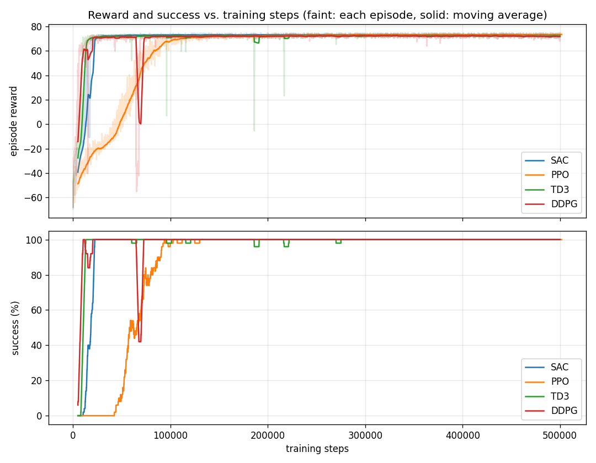

# Trained policies: Reach, fixed goal

Four policies trained on **Task 1 (Reach)** with **one fixed goal**, so you can evaluate them, compare them, or run them on the real Reachy 2 without retraining.

| | |
|---|---|
| Goal | **(0.40, −0.20, 0.00) m** in the torso frame (x forward, y left, z up) |
| Joints | 4: shoulder pitch, shoulder roll, elbow yaw, elbow pitch (`--no-wrist`; the wrist stays at 0°) |
| Training | 500,000 steps each, seed 0, default Stable-Baselines3 hyperparameters, trained 2026-10-26 |
| Code | `main` of this repo at that date (`scripts/train.py`) |

**These policies only know this one goal.** Always use `--goal 0.40 -0.20 0.00` with them. For any other point, train on random goals instead (see [docs/TASK1_REACH.md](../../docs/TASK1_REACH.md)).

## Results

Evaluated on 100 episodes with the same goal and unseen start poses:

| Algorithm | Reached and held (1 s) | Final distance (mean / worst) | Time to reach | Shield interventions |
|---|---|---|---|---|
| SAC | 100% | 0.3 cm / 0.3 cm | 1.0 s | 0 |
| PPO | 100% | 0.3 cm / 0.3 cm | 1.0 s | 0 |
| TD3 | 100% | 0.8 cm / 1.0 cm | 1.1 s | 0 |
| DDPG | 100% | 1.5 cm / 1.6 cm | 1.1 s | 0 |



All four reach 100% within about 100,000 steps. DDPG briefly collapsed around 65,000 steps and recovered.

## What's in each folder

```txt
<algo>/
├── model.zip             the final policy (500,000 steps)
├── args.json             how it was trained (algorithm, goal, steps, --no-wrist, seed)
├── monitor.monitor.csv   one line per training episode: reward, length, time, success
├── checkpoints/          the policy every 50,000 steps: model_<steps>_steps.zip
└── tensorboard/          TensorBoard logs
```

## Using them

From the repo root, with the venv active (`source .venv/bin/activate`; Windows: `.venv\Scripts\Activate.ps1`).

**Evaluate** (the algorithm is read from `args.json`):

```bash
python scripts/evaluate.py --model policies/reach_fixed_goal/sac/model.zip --goal 0.40 -0.20 0.00 --no-wrist
```

**Re-plot the comparison:**

```bash
python scripts/plot_rewards.py policies/reach_fixed_goal/sac policies/reach_fixed_goal/ppo policies/reach_fixed_goal/td3 policies/reach_fixed_goal/ddpg --out compare.png
```

**TensorBoard:**

```bash
tensorboard --logdir policies/reach_fixed_goal
```

**Real Reachy 2** — read [docs/RUN_REAL.md](../../docs/RUN_REAL.md) first (safety protocol, E-stop). Always start with a dry run; nothing moves:

```bash
python scripts/run_real.py --model policies/reach_fixed_goal/sac/model.zip --no-wrist --goal 0.40 -0.20 0.00
```

Only if the dry run ends in `SUCCESS` with few shield interventions, go live and slow:

```bash
python scripts/run_real.py --model policies/reach_fixed_goal/sac/model.zip --no-wrist --goal 0.40 -0.20 0.00 --live --speed 0.3
```

SAC is the recommended policy (fallback order SAC → PPO → TD3 → DDPG). These policies were trained in simulation only and have not yet been run live on the robot.
