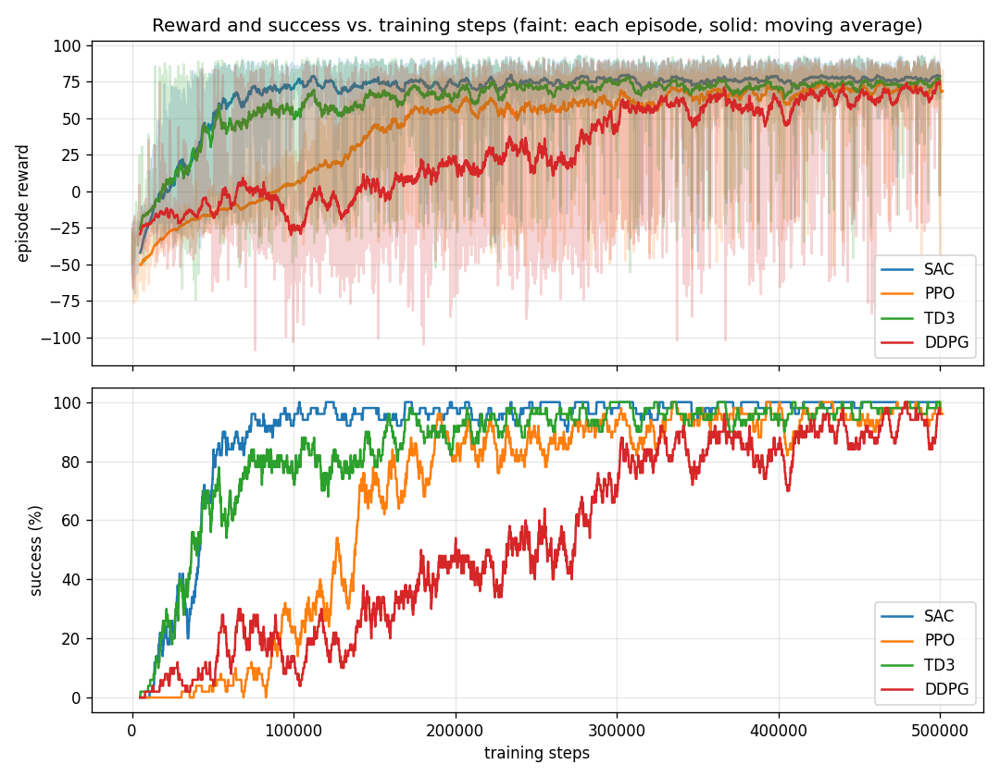

# Trained policies: Reach, random goals

Four policies trained on **Task 1 (Reach)** with a **new random goal every episode**, so they can reach **any point** in the workspace. Use these to evaluate, compare, or run on the real Reachy 2 without retraining.

| | |
|---|---|
| Goals | Random reachable points in the workspace box (torso frame): x 0.15…0.65, y −0.60…0.05, z −0.40…0.25 m |
| Joints | 4: shoulder pitch, shoulder roll, elbow yaw, elbow pitch (`--no-wrist`; the wrist stays at 0°) |
| Training | 500,000 steps each, seed 0, default Stable-Baselines3 hyperparameters, trained 2026-10-29 |
| Code | `main` of this repo at that date (`scripts/train.py`) |

## Results

Evaluated on 100 random goals and start poses never used in training:

| Algorithm | Reached and held (1 s) | Final distance (mean / worst) | Time to reach | Shield interventions |
|---|---|---|---|---|
| SAC | **100%** | 0.9 cm / 2.4 cm | 0.8 s | 3.2 |
| TD3 | 98% | 1.5 cm / 3.3 cm | 0.8 s | 3.6 |
| PPO | 96% | 1.8 cm / 42.6 cm | 0.9 s | 6.9 |
| DDPG | 91% | 2.0 cm / 32.1 cm | 0.9 s | 17.4 |



| Algorithm | Reaches ~90% success at | Notes |
|---|---|---|
| SAC | ~70k steps | Fastest and smoothest; near 100% from ~150k |
| TD3 | ~200k steps | Stuck around 80% until ~200k, then climbs to ~98% |
| PPO | ~200k steps | Slow start (on-policy), steady afterwards |
| DDPG | ~350k steps | Slowest and noisiest |

With only 100k steps the same setup gave SAC 97%, TD3 72% and DDPG 4%: TD3 and DDPG need far more training than SAC. These are single runs (seed 0); repeat with other seeds before relying on the TD3 / PPO order.

## What's in each folder

```txt
<algo>/
├── model.zip             the final policy (500,000 steps)
├── args.json             how it was trained (algorithm, steps, --no-wrist, seed; goal: null = random)
├── monitor.monitor.csv   one line per training episode: reward, length, time, success
├── checkpoints/          the policy every 50,000 steps: model_<steps>_steps.zip
└── tensorboard/          TensorBoard logs
```

## Using them

From the repo root, with the venv active (`source .venv/bin/activate`; Windows: `.venv\Scripts\Activate.ps1`).

**Evaluate on 100 random goals** (no `--goal`; the algorithm is read from `args.json`):

```bash
python scripts/evaluate.py --model policies/reach_random_goal/sac/model.zip --no-wrist
```

**Evaluate on one specific point:**

```bash
python scripts/evaluate.py --model policies/reach_random_goal/sac/model.zip --goal 0.35 -0.30 -0.25 --no-wrist
```

**Move the goal in the viewer; the hand follows** (macOS: `mjpython`, Windows/Linux: `python`):

```bash
mjpython scripts/follow_ball.py --model policies/reach_random_goal/sac/model.zip
```

**Re-plot the comparison:**

```bash
python scripts/plot_rewards.py policies/reach_random_goal/sac policies/reach_random_goal/ppo policies/reach_random_goal/td3 policies/reach_random_goal/ddpg --out compare.png
```

**TensorBoard:**

```bash
tensorboard --logdir policies/reach_random_goal
```

**Real Reachy 2:** read [docs/RUN_REAL.md](../../docs/RUN_REAL.md) first (safety protocol, E-stop). Any goal inside the workspace box works. Always start with a dry run, where nothing moves:

```bash
python scripts/run_real.py --model policies/reach_random_goal/sac/model.zip --no-wrist --goal 0.35 -0.30 -0.25
```

Only if the dry run ends in `SUCCESS` with few shield interventions, go live and slow:

```bash
python scripts/run_real.py --model policies/reach_random_goal/sac/model.zip --no-wrist --goal 0.35 -0.30 -0.25 --live --speed 0.3
```

SAC is the recommended policy. These policies were trained in simulation only and have not yet been run live on the robot.
